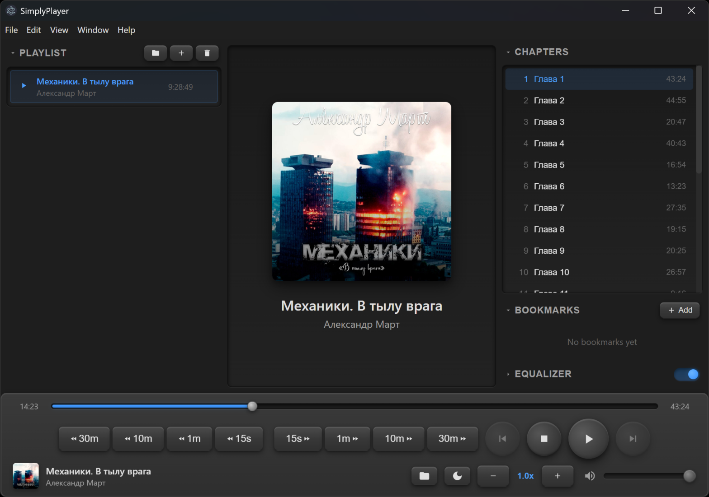

# SimplyPlayer

Desktop audio player for MP3/M4B with first-class audiobook support. Built with Electron, React and TypeScript.



## Features

- **Audiobook-oriented playback** — M4B chapter parsing and navigation, playback position persistence, resume exactly where you stopped
- **Bookmarks and sleep timer** — mark moments, fall asleep to a book safely
- **10-band equalizer** — with presets and persistence across restarts
- **Playlists** — drag-and-drop, prev/next, recursive folder scanning
- **Session restore** — playlist, track, position, volume and playback rate are restored on the next launch
- **Automatic updates** — the installed app updates itself from GitHub Releases (Squirrel.Windows)

## Download

Grab the latest `SimplyPlayer-x.y.z.Setup.exe` from
[GitHub Releases](https://github.com/DarkDeny/SimplyPlayer/releases/latest).
The installer updates the app in place; settings and sessions are kept.

## Development

```sh
npm install
npm start        # run in dev mode
npm run lint     # eslint
```

### Building on Windows

Use `make-win.cmd` — it puts the system Node.js first in `PATH`
(a Node.js shim from some agent runtimes breaks electron-packager)
and runs `npm run make`. Artifacts land in `out/make/squirrel.windows/x64/`.

### Releasing

Releases are built by GitHub Actions (see `.github/workflows/release.yml`):

```sh
npm version patch   # or minor / major
git push github main --tags
```

Pushing a `v*` tag builds the Squirrel package on `windows-latest`
and publishes `RELEASES`, `*.nupkg` and `Setup.exe` to GitHub Releases.
Installed instances pick the update up automatically on next launch.

## Code signing

Release binaries are planned to be signed with a Certum Open Source
code signing certificate issued to the maintainer. See
[CODE_SIGNING_POLICY.md](CODE_SIGNING_POLICY.md).

## License

[MIT](LICENSE)
